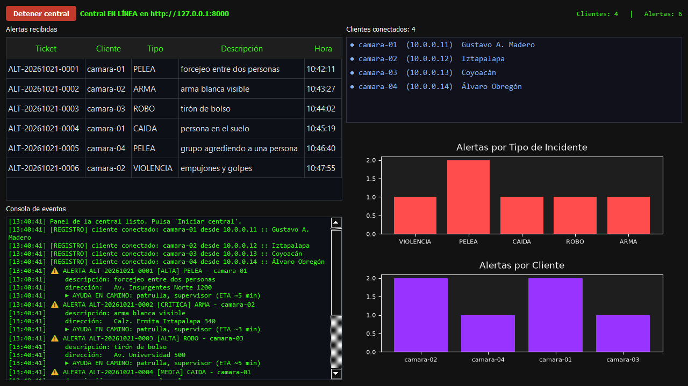
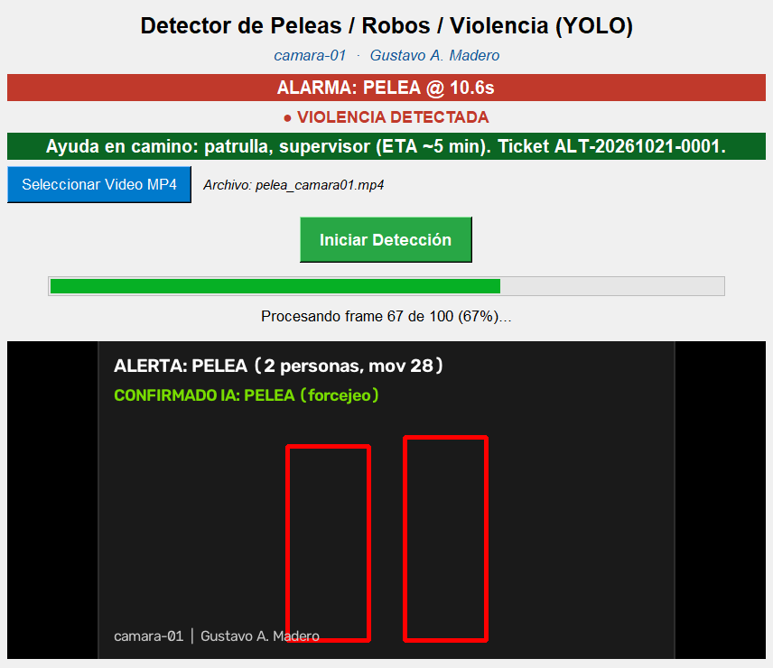

# 🚨 Detección de incidentes violentos con verificación por IA

<p align="center">
  <strong>YOLO propone. La IA local confirma. La central despacha.</strong><br>
  Sistema cliente-servidor de videovigilancia con doble verificación y alertas REST en tiempo real.
</p>

<p align="center">
  
  
  
  
  
  
  
</p>

<p align="center">
  
  <br>
  <sub>Central C5: alertas en vivo, clientes conectados y gráficas por tipo de incidente y por cámara.</sub>
</p>

Sistema cliente-servidor que analiza video de vigilancia, **sospecha** posibles
incidentes con YOLO, los **confirma** con un modelo de visión local (Ollama) y
envía una **petición de ayuda** a una central REST, que responde con ticket,
prioridad y tiempo estimado de llegada.

El objetivo es reducir falsos positivos: la alarma solo suena cuando dos
etapas independientes coinciden. Si la IA local no está disponible, el sistema
falla de forma segura (**no alarma**) y la detección continúa.

> **Estado:** proyecto de portafolio funcional. Probado en Windows con Python
> 3.14; requiere Python 3.11 o superior.

## Qué demuestra

- **Diseño de software:** arquitectura hexagonal con puertos y adaptadores, y
  una regla de dependencia que aísla el dominio de las librerías externas.
- **Concurrencia en Python:** pipeline con hilos, cola acotada, locks y una
  interfaz que nunca se bloquea.
- **Visión por computador:** YOLO + heurísticas para proponer sospechas y un
  modelo de visión local para confirmarlas.
- **Backend:** API REST con FastAPI y Pydantic, validación de rangos,
  autenticación opcional por API key y webhook de despacho.
- **Escritorio:** dos GUIs desacopladas del negocio (Tkinter para el cliente,
  PyQt5 para el dashboard).
- **Calidad:** 31 tests con dobles de prueba, lint con Ruff, configuración por
  entorno y documentación de arquitectura y API.

## Arquitectura en 30 segundos

```
┌────────────────────── CLIENTE (una cámara) ──────────────────────┐
│  Video MP4 ──▶ YOLO + heurísticas ──▶ sospecha                   │
│                                        │                         │
│                                        ▼                         │
│                               Ollama (modelo de visión)          │
│                                        │ confirmación           │
│                    alarma local ◀───────┤                         │
│                    video anotado        ▼                         │
│                    reporte JSON    POST /api/v1/alertas ─────────┼──┐
│                    "Ayuda en camino" ◀───────────────────────────┼──┤
└──────────────────────────────────────────────────────────────────┘  │
                                                                      ▼
                                             ┌──────── CENTRAL C5 ─────────┐
                                             │ FastAPI + dashboard PyQt5   │
                                             │ alertas · clientes · gráficas│
                                             └─────────────────────────────┘
```

## Características

- **Pipeline de dos etapas** para reducir falsos positivos (YOLO propone,
  Ollama dispone).
- **Arquitectura hexagonal**: dominio y casos de uso aislados de YOLO,
  OpenCV, Ollama, Tkinter y FastAPI.
- **Multi-cliente**: cada cámara se registra y envía latidos; la central
  muestra quién está en línea.
- **Tolerancia a fallos**: fail-closed en la verificación y fail-open en el
  envío. Un fallo de red no detiene la detección local.
- **Concurrencia controlada**: la verificación corre en un hilo worker con
  cola acotada; la GUI nunca se bloquea.
- **Evidencia**: video anotado, reporte JSON por corrida y snapshot JPEG
  opcional adjunto a la alerta.
- **API documentada** automáticamente con OpenAPI/Swagger.
- **Tests** de heurísticas, parser del veredicto, despacho, almacén, registro
  y orquestación del caso de uso.

## Vista del cliente

<p align="center">
  
  <br>
  <sub>Una ventana por cámara: video anotado, alarma local y respuesta de la central.</sub>
</p>

## Stack

`Python 3.11+` · `Ultralytics YOLO11` · `OpenCV` · `Ollama` · `FastAPI` ·
`Pydantic` · `PyQt5` · `Tkinter` · `pytest` · `ruff`

## Estructura del proyecto

```text
.
├── incidentes/
│   ├── domain/                 # Entidades y puertos (sin dependencias externas)
│   ├── application/            # Caso de uso: detección en dos etapas
│   ├── infrastructure/         # Adaptadores: YOLO, OpenCV, Ollama, REST, audio
│   ├── presentation/           # GUI del cliente (Tkinter)
│   ├── central/                # Dashboard de la central (PyQt5)
│   ├── server/                 # API REST (FastAPI): alertas y clientes
│   ├── cli/                    # Composition roots y herramientas
│   ├── config.py               # Configuración por entorno (inmutable)
│   └── logging_setup.py
├── tests/                      # Pruebas unitarias y de orquestación
├── docs/
│   ├── arquitectura.md         # Capas, flujos y decisiones de diseño
│   └── api.md                  # Contrato REST de la central
├── pyproject.toml              # Dependencias, scripts y configuración de tools
└── .env.example                # Variables de entorno documentadas
```

## Requisitos

- Python **3.11+**.
- [Ollama](https://ollama.com/) con un modelo de visión (por defecto
  `qwen2.5vl:7b`).
- ~2 GB de disco para dependencias y pesos de YOLO. Los pesos
  (`yolo11n.pt`) se descargan automáticamente en el primer uso.
- Opcional: GPU compatible con PyTorch para acelerar la inferencia.

## Instalación

```bash
git clone <URL_DEL_REPOSITORIO>
cd deteccion-incidentes

python -m venv .venv
# Windows
.venv\Scripts\activate
# Linux/macOS
source .venv/bin/activate

# Cliente + central + herramientas de desarrollo
python -m pip install -e ".[central,dev]"
```

Prepara el modelo de visión:

```bash
ollama serve
ollama pull qwen2.5vl:7b
```

## Inicio rápido

### 1. Verificar el contrato REST (sin video ni Ollama)

```bash
python -m incidentes.cli.smoke_test
```

Levanta la API en un puerto libre, registra un cliente, envía una alerta y
muestra el ticket y el historial. Es la forma más rápida de comprobar que todo
está instalado.

### 2. Sistema completo

```bash
# Terminal 1: dashboard + API REST en http://127.0.0.1:8000
python -m incidentes.cli.central

# Terminal 2: abre 4 ventanas, una por cámara/localidad
python -m incidentes.cli.launch_clients --clients 4
```

En cada ventana: **Seleccionar Video MP4 → Iniciar Detección**. Cuando la IA
confirme violencia, sonará la alarma, se guardará el video anotado y el
`*_reporte.json`, y la central responderá con el ticket y la ayuda en camino.

También puedes arrancar todo en orden con:

```bash
python -m incidentes.cli.deploy --clients 4
```

### 3. Diagnosticar un video que no genera alarmas

```bash
python -m incidentes.cli.diagnose "C:\videos\pelea.mp4"
```

Indica si falla YOLO (no ve personas), la heurística (no hay grupos/movimiento)
o el modelo de visión (no confirma la escena).

## Configuración

La configuración del cliente se lee de variables de entorno con prefijo
`INCIDENTES_` y puede sobrescribirse con argumentos de línea de comandos. Los
valores disponibles están documentados en [`.env.example`](.env.example).

| Variable | Defecto | Uso |
|---|---|---|
| `INCIDENTES_CLIENT_ID` | `camara-01` | Identidad del cliente ante la central |
| `INCIDENTES_LOCATION_ADDRESS` | `Sin dirección configurada` | Dirección reportada en la alerta |
| `INCIDENTES_CENTRAL_URL` | `http://localhost:8000` | URL de la central |
| `INCIDENTES_CENTRAL_API_KEY` | *(vacío)* | Debe coincidir con `CENTRAL_API_KEY` |
| `INCIDENTES_OLLAMA_MODEL` | `qwen2.5vl:7b` | Modelo de visión |
| `INCIDENTES_OLLAMA_URL` | `http://localhost:11434` | Servidor de Ollama |
| `INCIDENTES_CONFIDENCE` | `0.5` | Confianza mínima de YOLO |
| `INCIDENTES_ALERT_ONCE` | `true` | Una alerta por video procesado |
| `CENTRAL_API_KEY` | *(vacío)* | Si se define, exige `X-API-Key` |
| `DISPATCH_WEBHOOK_URL` | *(vacío)* | Webhook opcional para avisar a unidades |
| `CLIENT_ALIVE_SEC` | `30` | Segundos sin latido para marcar un cliente caído |

`.env` **no se carga automáticamente**: exporta las variables en tu shell o usa
tu gestor de entornos habitual.

## Cómo funciona

1. **Detección de sospechas.** YOLO11n (COCO) detecta personas, armas y
   bolsos. Las heurísticas buscan proximidad entre personas, movimiento alto,
   personas caídas y combinaciones compatibles con robo. Una señal debe
   persistir varios frames para convertirse en sospecha.
2. **Verificación.** La sospecha se envía a Ollama junto con un JPEG reducido.
   El modelo responde un JSON con `violent`, `type`, `confidence` y `reason`.
   Solo `violent=true` genera un evento.
3. **Alerta.** El cliente suena la alarma, escribe el video anotado y el
   reporte JSON, y hace `POST /api/v1/alertas`. La central calcula prioridad,
   ETA y unidades, responde con un ticket y, opcionalmente, notifica por
   webhook.
4. **Presencia.** El cliente se registra y envía latidos periódicos; la central
   lo marca como desconectado si deja de latir.

Detalles de diseño, concurrencia y decisiones en
[`docs/arquitectura.md`](docs/arquitectura.md).

## API de la central

La API se documenta sola en `http://localhost:8000/docs`. Resumen de
endpoints, autenticación y ejemplos `curl` en [`docs/api.md`](docs/api.md).

La central **no persiste nada**: las alertas viven en memoria mientras el
proceso está en marcha. Es un receptor en vivo, no una base de datos.

## Tests y calidad

```bash
pytest          # pruebas
ruff check .    # estilo y errores comunes
ruff format .   # formateo (opcional)
```

Las pruebas no necesitan cámara, video, Ollama ni PyQt5: usan dobles de prueba
para el caso de uso y funciones puras para las heurísticas.

## Decisiones y limitaciones

- **YOLO11n no tiene clases de "pelea" ni "robo".** El sistema usa señales
  indirectas y por eso la segunda etapa es imprescindible. Si entrenas un
  modelo propio (`violence.pt`), el detector lo usa y omite la heurística.
- **La heurística es deliberadamente conservadora.** Un video con una sola
  persona, poca resolución o mucho movimiento de cámara puede no generar
  sospechas; el diagnóstico ayuda a ajustar los umbrales.
- **El análisis es sobre video grabado**, no en tiempo real desde una cámara
  IP. El diseño de puertos permite añadir un `VideoReader` en vivo sin tocar
  el caso de uso.
- **La central es efímera** (memoria). Persistir histórico solo requiere otra
  implementación de `AlertStore`.
- **La alarma es local al cliente**; el despacho real depende de un webhook
  externo. Sin `DISPATCH_WEBHOOK_URL`, el plan queda registrado en el log y en
  el dashboard.

## Roadmap

- [ ] Lector de cámara RTSP en vivo.
- [ ] Persistencia opcional (SQLite/PostgreSQL) del historial de alertas.
- [ ] Autenticación por cliente y roles en la central.
- [ ] Modelo propio de violencia y evaluación con métricas (precisión/recall).
- [ ] Contenedores Docker para central y cliente.
- [ ] Integración continua (lint + tests) en GitHub Actions.
